# Securing a Linux Server with firewalld

**Course:** ITSY 2300 – Operating System Security (Lab L5)
**Tools:** firewalld, nftables, nmap, journalctl
**Environment:** VMware Workstation, Ubuntu Server, Kali Linux, custom router VM

## Overview

In this lab I replaced Ubuntu's default firewall front-end (ufw) with **firewalld** and hardened an Ubuntu server with a default-deny policy. I allowed only specific services, built an admin-only ping allowlist using an ipset and rich rules, and turned on logging for dropped packets.

Then I switched to the attacker's side and scanned the server from Kali with nmap to see what the firewall still revealed. I found that an allowed UDP port leaked its state through ICMP replies, and I closed that leak with a custom **nftables** rule.

This lab continues my [nftables firewall lab (L4)](../nftables-firewall). L4 built rules by hand in nftables. Here, firewalld manages those rules for me.

## Lab Network

| Host | Role | IP |
|---|---|---|
| Router VM | Gateway / admin machine | 172.19.201.1 |
| Host PC (Windows) | Admin workstation | 172.19.201.2 |
| Ubuntu Server 1 | Target server | 172.19.201.3 |
| Kali Linux | Attacker | 172.19.201.30 |

Network: VMnet2 (host-only), static IPs.

---

## 1. Baseline: No Firewall

Before configuring anything, I scanned the server from Kali to see what an attacker sees with no firewall in place.

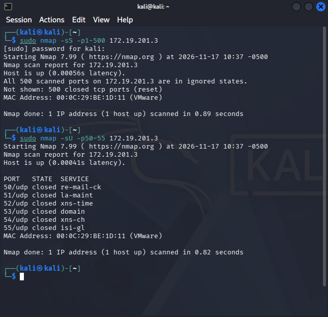

All 500 TCP ports and all 6 UDP ports came back **closed**. Nothing was listening, but the server still answered every probe, so it confirmed it was alive and gave a definite answer about every port.

## 2. Install firewalld and Move to the DMZ Zone

I disabled ufw so the two front-ends wouldn't write conflicting rules, then installed and enabled firewalld. firewalld groups rules into **zones**, and each network interface gets exactly one zone. I made `dmz` the default zone and bound it to `ens33`:

```bash
sudo firewall-cmd --set-default-zone=dmz
sudo firewall-cmd --zone=dmz --add-interface=ens33 --permanent
sudo firewall-cmd --reload
```

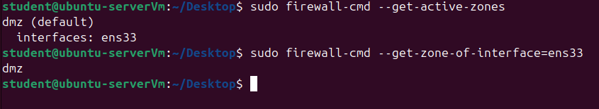

**Key point:** `--permanent` changes don't take effect until you reload. Changes made without it apply immediately but are lost on reboot.

## 3. Allow Services and Set a Default-Deny Policy

I allowed web traffic, then switched the zone's target to **DROP** so anything not explicitly allowed is discarded silently:

```bash
sudo firewall-cmd --add-service={http,https} --permanent
sudo firewall-cmd --set-target=DROP --zone=dmz --permanent
sudo firewall-cmd --reload
```

Pings from the host PC and the router now got no reply at all:

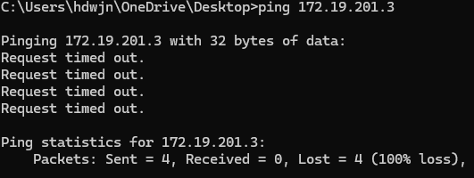

Outgoing pings from the server still worked, because firewalld is **stateful** and lets replies to the server's own connections back in.

## 4. Log Dropped Packets

Logging of denied packets is **off by default**, since it can flood the logs on a busy server. I turned it on and pinged the server from the router:

```bash
sudo firewall-cmd --set-log-denied=all
sudo journalctl -k | grep PROTO=ICMP | tail
```

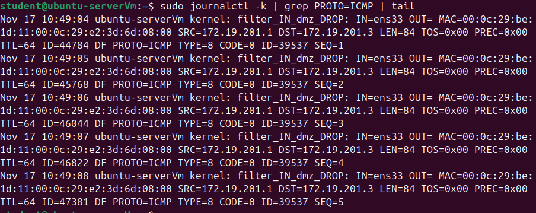

Each entry shows the zone that dropped it (`filter_IN_dmz_DROP`), the source and destination MAC and IP addresses, and the ICMP type/code (`TYPE=8 CODE=0`, Echo Request). There's one entry for each ping sequence number.

## 5. Admin Allowlist with ipsets and Rich Rules

Blocking all pings also locks out administrators who need ping for troubleshooting. I created an **ipset** holding the router and host PC, then a **rich rule** that accepts echo requests only from that set:

```bash
sudo firewall-cmd --new-ipset=Echoes_Allowed --type=hash:net --permanent
sudo firewall-cmd --ipset=Echoes_Allowed --add-entries-from-file=iplist_allow_echoes.txt --permanent
sudo firewall-cmd --add-rich-rule='rule family=ipv4 source ipset=Echoes_Allowed destination address=172.19.201.3 icmp-type name=echo-request accept' --permanent
```

Using an ipset means I can add or remove admin IPs later without touching the rule itself. The host PC could ping the server again:

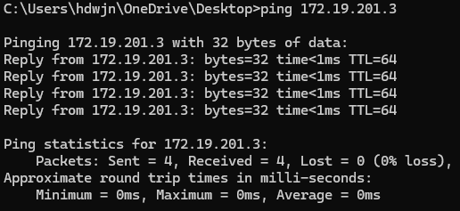

I also added a rule allowing DNS (UDP 53) from the local subnet:

```bash
sudo firewall-cmd --add-rich-rule='rule family=ipv4 source address=172.19.201.0/27 port port=53 protocol=udp accept' --permanent
```

Final zone configuration:

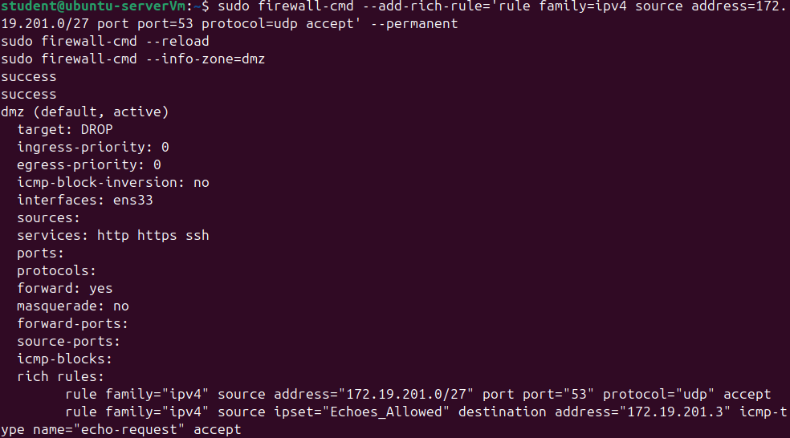

## 6. Under the Hood: firewalld → nftables

firewalld is a front-end. Every rule I created was translated into nftables rules in the kernel:

```bash
sudo nft list ruleset | grep Echoes_Allowed
```

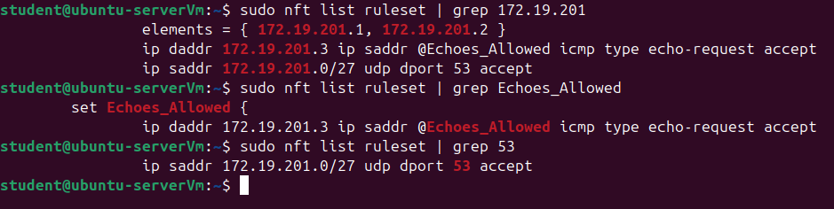

The rich rule became `ip daddr 172.19.201.3 ip saddr @Echoes_Allowed icmp type echo-request accept`, the same syntax I wrote by hand in Lab L4.

## 7. Attacker's View: Testing from Kali

Kali (.30) isn't in the allowlist, so its pings were dropped:

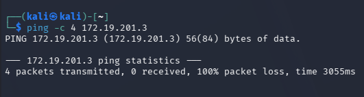

Then I re-ran the same scans from the baseline:

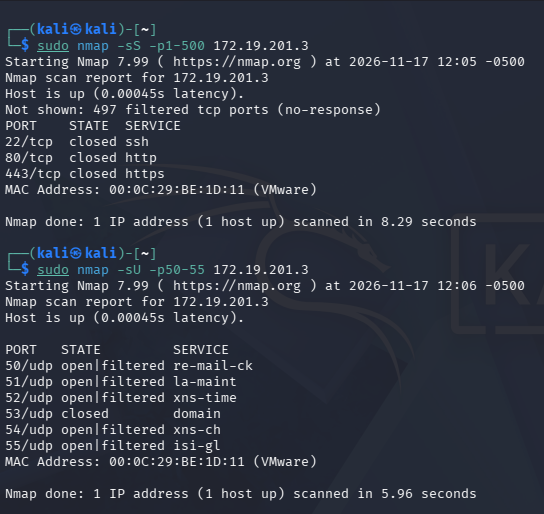

| | Before | After firewalld |
|---|---|---|
| TCP 1–500 | 500 closed | **497 filtered**, 3 closed (22, 80, 443) |
| UDP 50–55 | 6 closed | 5 open\|filtered, **53 closed** |
| Scan time | 0.89 s | 8.29 s |

- Only the ports the firewall allows respond. Everything else is silently dropped (**filtered**).
- 22, 80, and 443 show **closed**, not open: the firewall lets them through, but no service is running on them.
- The TCP scan took about 10× longer because nmap had to wait out timeouts on dropped packets.

**The leak:** UDP 53 shows **closed**. The firewall allows it, nothing is listening, so the kernel replies with *ICMP Destination Unreachable – Port Unreachable*. That reply tells an attacker exactly which UDP port the firewall lets through.

## 8. Closing the Leak with nftables

I created a separate nftables table with an output chain that drops outgoing ICMP type 3, code 3 (Port Unreachable) messages:

```bash
sudo nft add table inet ICMP_OUT_FILTER
sudo nft add chain inet ICMP_OUT_FILTER output { type filter hook output priority 0\; policy accept\; }
sudo nft add rule inet ICMP_OUT_FILTER output oifname ens33 icmp type 3 icmp code 3 drop
```

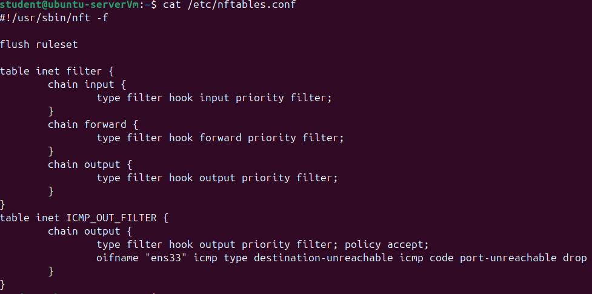

Re-running the UDP scan from Kali:

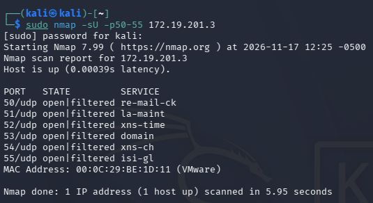

All six ports, including 53, now show **open|filtered**. The attacker can no longer tell the allowed port apart from the blocked ones.

---

## Key Takeaways

- **Default-deny** (`target: DROP`) plus explicit allows is the right baseline for any firewall.
- **DROP vs. REJECT:** DROP gives the sender nothing. REJECT sends back an error, which confirms the host exists and that a firewall is filtering.
- **Open / closed / filtered** in nmap: *open* means a service answered, *closed* means the host answered but nothing was listening (so the firewall allowed it), and *filtered* means the firewall dropped it and nothing came back.
- A port the firewall allows can still leak information through the host's own error replies. Hardening means controlling what the server **sends back**, not just what it lets in.
- firewalld and ufw are front-ends. **nftables/netfilter** is the actual kernel firewall, so each machine should be managed by only one front-end.

## Skills Demonstrated

Linux firewall administration (firewalld, nftables) · zone-based policy · ipsets and rich rules · packet logging and log analysis · network reconnaissance with nmap (SYN and UDP scans) · testing my own defenses from the attacker's side
