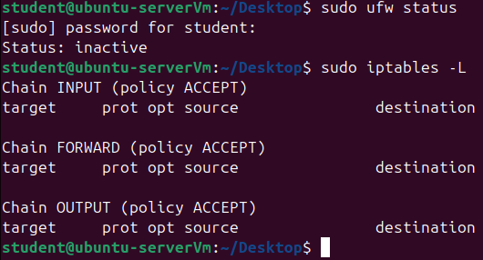
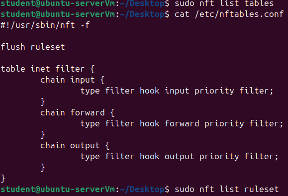
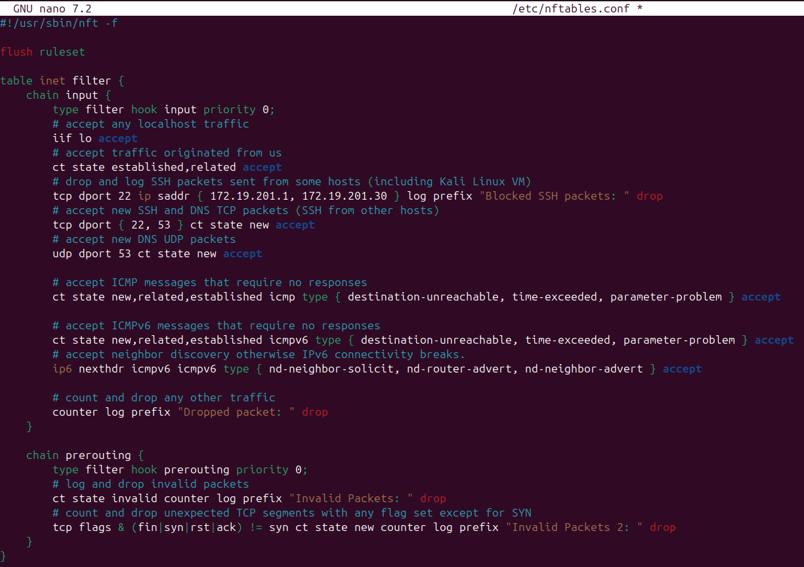
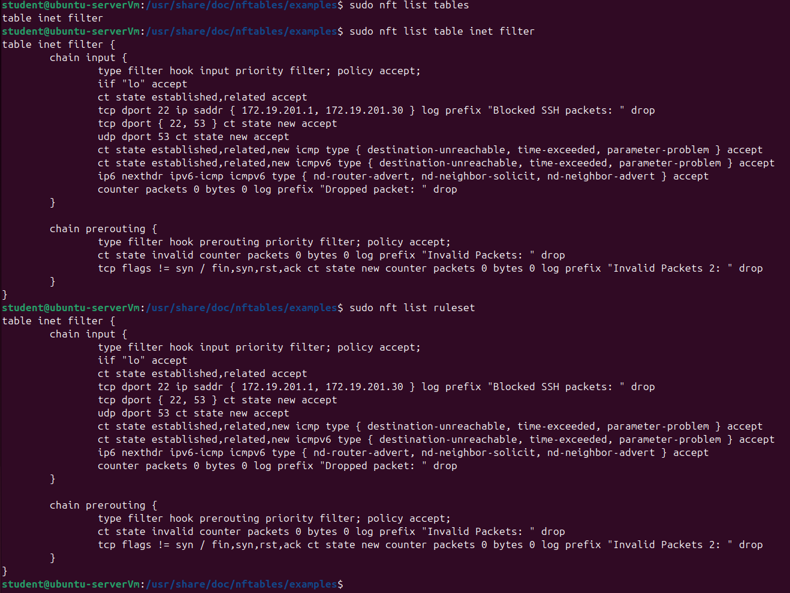
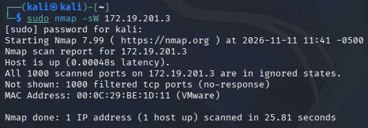
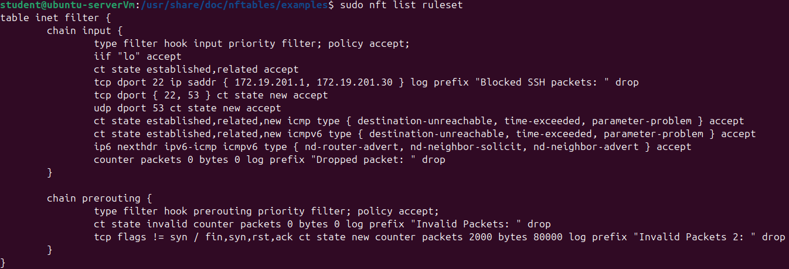
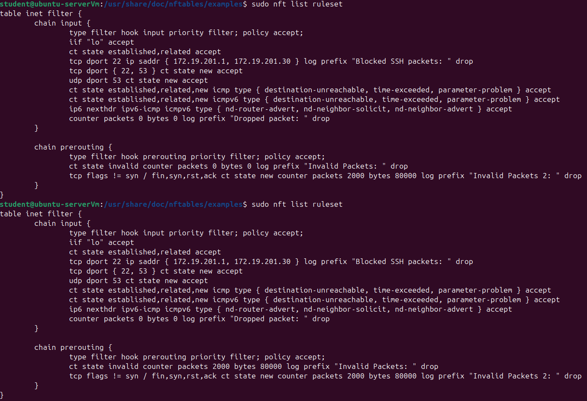
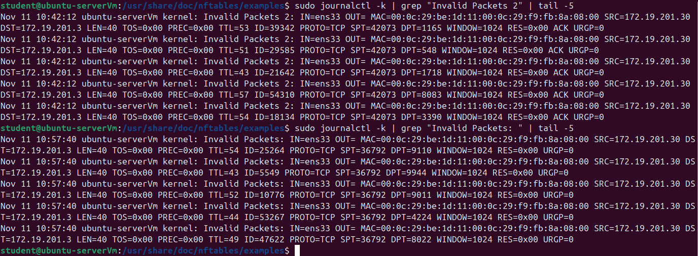
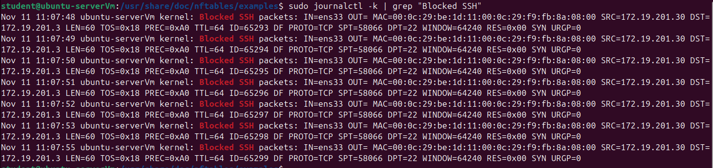
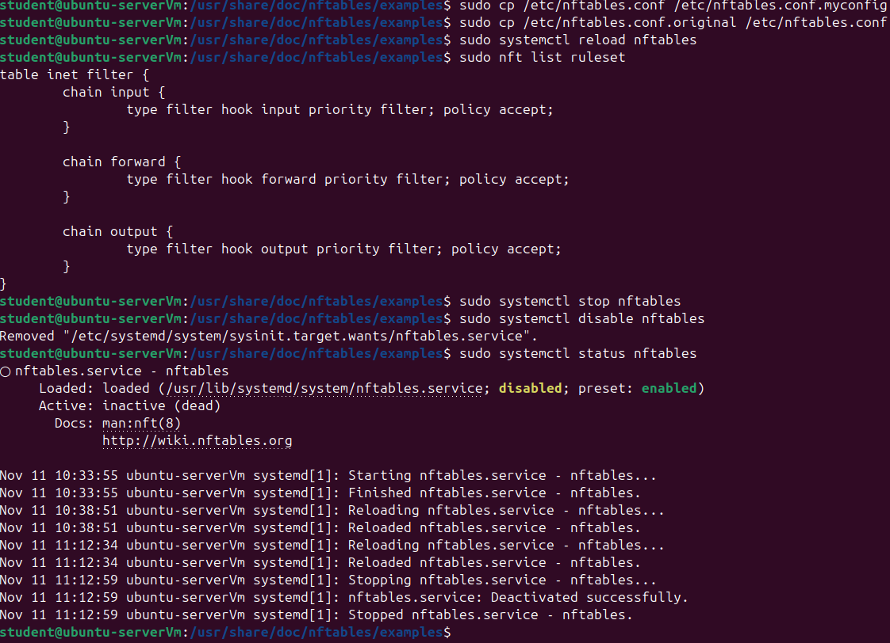

# Linux Host Firewall with nftables — Configuration & Attack Testing

Built and tested a host-based firewall on Ubuntu Server using **nftables**, then attacked it from a **Kali Linux** VM with stealth port scans to verify which rules caught the traffic.

## Overview

Linux's firewall is **netfilter**, which is built into the kernel. Users can't interact with netfilter directly, so a helper tool is needed to load rules into it. This lab uses **nftables**, the modern replacement for iptables. nftables handles IPv4 and IPv6 in one table, lets a single rule do several things at once (count, log, and drop), and uses a readable configuration file.

In this lab I:
- Verified that no older firewalls (ufw / iptables) were active
- Installed nftables and inspected its default configuration
- Wrote a custom ruleset that blocks SSH from specific hosts, allows only required services, and drops malformed TCP packets
- Attacked the server from Kali with **TCP window** and **TCP null** scans, plus a blocked SSH attempt
- Used rule counters and kernel logs to confirm which rule caught each attack
- Reverted the server to its default configuration

## Lab Environment

All VMs run in VMware Workstation Pro on an isolated host-only network (VMnet2).

| Machine | Role | IP Address |
|---|---|---|
| Router VM (Ubuntu Server) | Gateway / NAT to internet | 172.19.201.1 |
| Host PC (Windows) | Management / SSH | 172.19.201.2 |
| Ubuntu Server 1 | Target (firewall host) | 172.19.201.3 |
| Kali Linux | Attacker | 172.19.201.30 |

**Tools:** nftables, nmap, journalctl, systemctl, VMware Workstation Pro

---

## 1. Check for Existing Firewalls

Confirmed that ufw was inactive and no iptables rules were loaded, so nftables would be the only firewall in use.

```bash
sudo ufw status
sudo iptables -L
```



## 2. Install nftables and Inspect the Defaults

```bash
sudo apt update
sudo apt install nftables -y
```

By default, the config file defines a table with three empty chains, but the service isn't running, so **no tables or rules are active**.

```bash
sudo nft list tables
cat /etc/nftables.conf
sudo nft list ruleset
```



## 3. Write the Custom Ruleset

I backed up the default config, then replaced it with my own ruleset. The full file is in [`nftables.conf`](nftables.conf).

```bash
sudo systemctl enable nftables.service
sudo systemctl start nftables
sudo cp /etc/nftables.conf /etc/nftables.conf.original
sudo nano /etc/nftables.conf
sudo systemctl reload nftables
```



### What the rules do

**Input chain** (traffic arriving at the server):

| Rule | Purpose |
|---|---|
| `iif lo accept` | Allow localhost traffic |
| `ct state established,related accept` | Allow replies to connections the server started |
| `tcp dport 22 ip saddr { .1, .30 } log ... drop` | **Block and log SSH** from the router and Kali |
| `tcp dport { 22, 53 } ct state new accept` | Allow new SSH and DNS (TCP) from other hosts |
| `udp dport 53 ct state new accept` | Allow DNS over UDP |
| ICMP / ICMPv6 rules | Allow essential error messages and IPv6 neighbor discovery |
| `counter log ... drop` | **Default deny:** count, log, and drop everything else |

**Prerouting chain** (inspects packets before any routing decision):

| Rule | Purpose |
|---|---|
| `ct state invalid ... drop` | Drop packets that connection tracking marks as **invalid** |
| `tcp flags & (fin\|syn\|rst\|ack) != syn ct state new ... drop` | Drop "new" connections that **don't start with a SYN**, which is a sign of a scan |

After reloading, the ruleset was active with every counter at zero:

```bash
sudo nft list ruleset
```



---

## 4. Attack the Server from Kali

### TCP Window Scan

A window scan sends packets with only the **ACK** flag set to the 1,000 most common ports.

```bash
sudo nmap -sW 172.19.201.3
```



Nmap reported all **1,000 ports as filtered (no-response)**: the firewall dropped every probe silently, so the attacker learned nothing about which ports were open.

**Result:** the **"Invalid Packets 2"** rule caught the scan, with **2,000 packets / 80,000 bytes**. A real TCP connection always begins with SYN, so a "new" connection that starts with ACK is dropped. The numbers line up: 1,000 ports × 2 attempts = 2,000 packets, and 2,000 × 40-byte headers = 80,000 bytes.



### TCP Null Scan

A null scan sends packets with **no TCP flags set**.

```bash
sudo nmap -sN 172.19.201.3
```

**Result:** this time the **"Invalid Packets"** rule (`ct state invalid`) caught it, again with **2,000 packets / 80,000 bytes**. No legitimate TCP packet has zero flags, so connection tracking marked these as invalid immediately. Both prerouting counters now show the two scans side by side:



### Comparing the Two Scans

| Scan | TCP Flags | Connection Tracking Verdict | Rule Triggered |
|---|---|---|---|
| Window (`-sW`) | ACK | New, but not SYN | Invalid Packets 2 |
| Null (`-sN`) | None | Invalid | Invalid Packets |

The two prerouting rules cover **different kinds of malformed traffic**, so each scan was stopped by a different rule. This is an example of defense in depth inside a single firewall.

### Firewall Logs

Every dropped probe was written to the kernel log, showing the attacker's IP (`SRC=172.19.201.30`), the target port (`DPT=`), and the TCP flags.

```bash
sudo journalctl -k | grep "Invalid Packets 2" | tail -5
sudo journalctl -k | grep "Invalid Packets: " | tail -5
```



The difference between the scans shows up in the logs: window-scan entries end with the `ACK` flag, while null-scan entries have **no flag at all**, which is why they matched different rules.

### SSH Block Test

From Kali, I attempted an SSH connection to the server. The connection hung with no response, and the firewall logged every attempt with the "Blocked SSH packets" prefix.

```bash
ssh student@172.19.201.3          # from Kali — hangs
sudo journalctl -k | grep "Blocked SSH"   # on Ubuntu
```



The log shows Kali's SSH client resending its SYN about once per second. The firewall silently dropped every attempt, so the client never got a response and eventually timed out.

---

## 5. Revert to the Default Configuration

Saved my custom config, restored the original, then stopped and disabled the service.

```bash
sudo cp /etc/nftables.conf /etc/nftables.conf.myconfig
sudo cp /etc/nftables.conf.original /etc/nftables.conf
sudo systemctl reload nftables
sudo nft list ruleset
sudo systemctl stop nftables
sudo systemctl disable nftables
sudo systemctl status nftables
```

The ruleset returned to the default empty chains, and the service now shows **inactive (dead)** and **disabled**.



---

## Troubleshooting

Problems I solved while setting up the lab:

- **IP address conflict:** Kali couldn't bring up its static IP (`172.19.201.30`) because the Windows host's VMnet2 adapter was already using that address. Fixed by setting the host adapter to its assigned `.2` address.
- **No internet through the router VM:** Ubuntu could ping every lab machine, but `apt update` stalled at 0%. I worked through the path layer by layer: local connectivity, gateway, DNS, then the router's IP forwarding. After that, I confirmed forwarding was saved in `/etc/sysctl.conf` so it survives reboots.
- **Kali VM display issues:** the pre-built Kali image needed a VMware hardware compatibility upgrade before it would display correctly.

## Key Takeaways

- Host-based firewalls add a layer of defense that limits lateral movement even inside a trusted network
- A **default-deny** policy (drop everything not explicitly allowed) is safer than trying to block known-bad traffic
- **Connection tracking** lets the firewall judge whether a packet makes sense in context, not just which port it targets
- Rule **counters and logging** turn a firewall from a silent filter into a detection tool. I could see exactly which rule stopped each attack and where it came from
- Stealth scans like window and null scans can be detected and blocked by validating TCP flags